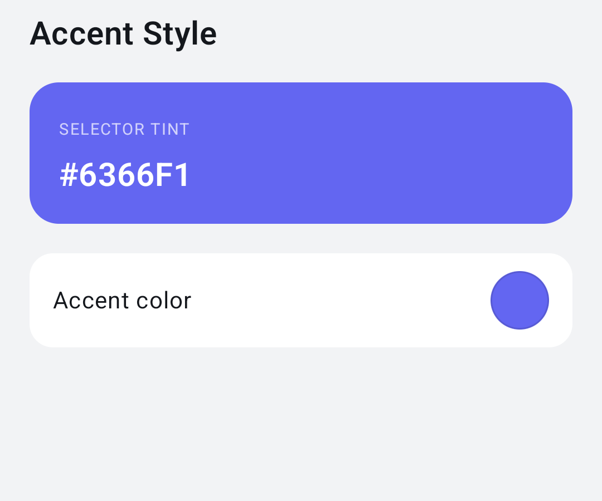
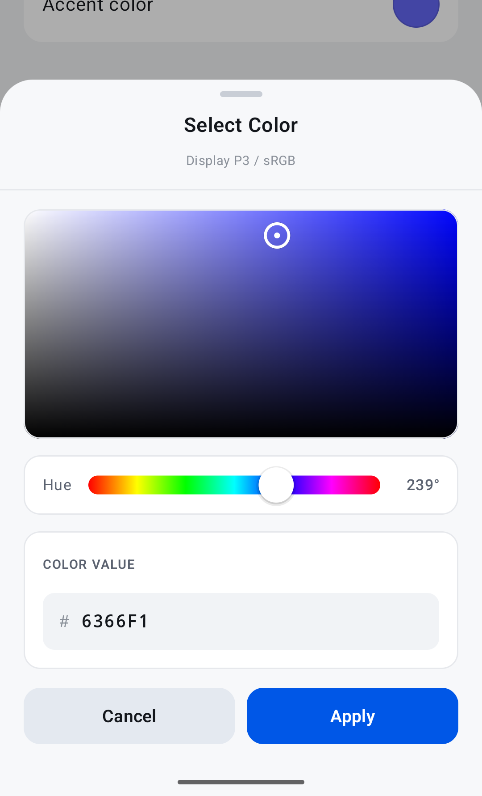
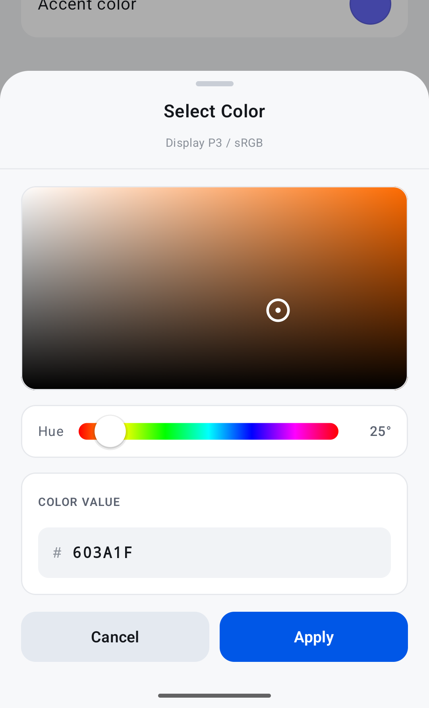
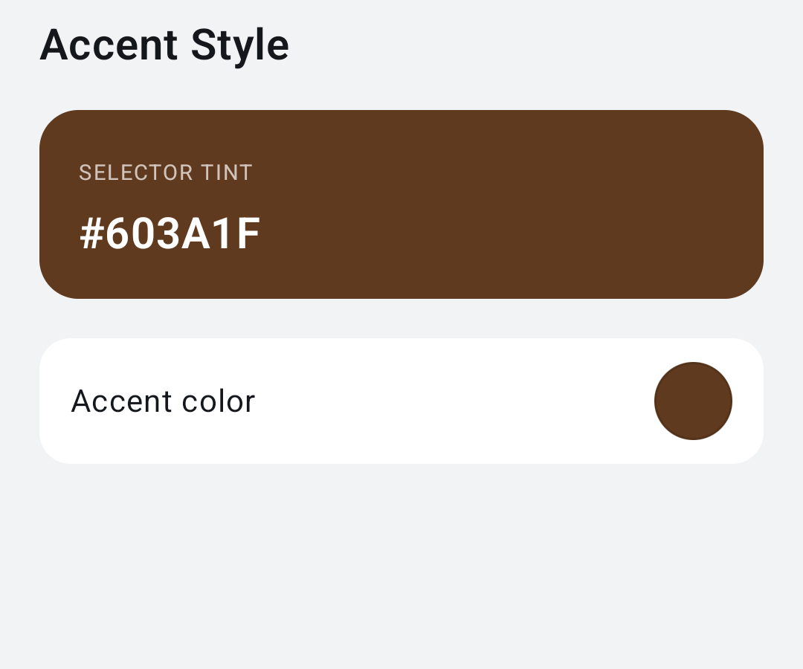

# Color Picker

A reusable Jetpack Compose color picker. `ColorPickerSwatch` draws the selected color as a circle. Tapping the circle opens a bottom sheet. The color you pass in changes only when the user taps **Apply**.

## Add the library

The picker lives in the `:colorpicker` module (`com.raztamim.colorpicker`). It needs Jetpack Compose and Material 3, and `minSdk` 24.

```kotlin
dependencies {
    implementation(project(":colorpicker"))
}
```

`:app` is a small sample that wires the swatch to a tint card.

## Pick a color

Hold the color in your own state and pass it to the swatch:

```kotlin
var accent by remember { mutableStateOf(Color(0xFF6366F1)) }

ColorPickerSwatch(
    color = accent,
    onColorSelected = { accent = it },
)
```

Tapping the circle opens the sheet on the current color.



Inside the sheet:

- Drag or tap the panel to set saturation and brightness. The ring stays inside the panel.
- Drag the hue slider. The label on the right shows the hue in degrees.
- Type a color into the hex field. `RRGGBB` and `AARRGGBB` both work, with or without a leading `#`. The panel and slider follow a valid value, and moving the panel rewrites the field when it is not focused.




**Apply** calls `onColorSelected` with the new color. **Cancel**, swiping the sheet down, or tapping the dimmed area calls nothing and leaves your state as it was. In the editing screenshot above, the card behind the sheet still shows `#6366F1` because Apply has not been tapped yet.



## Open the sheet yourself

Use `ColorPickerDialog` when the trigger is your own button or row. The sheet does not remember a selection across openings: each time it starts from `initialColor`.

```kotlin
var showPicker by remember { mutableStateOf(false) }

if (showPicker) {
    ColorPickerDialog(
        initialColor = accent,
        onDismiss = { showPicker = false },
        onApply = {
            accent = it
            showPicker = false
        },
        subtitle = "Display P3 / sRGB",
    )
}
```

`subtitle` defaults to `null` on the dialog. The swatch passes `"Display P3 / sRGB"` unless you override it.

## Public API

### `ColorPickerSwatch`

| Parameter | Default | |
| --- | --- | --- |
| `color` | | Color drawn in the circle. |
| `onColorSelected` | | Called with the chosen color when the user taps Apply. |
| `modifier` | `Modifier` | |
| `size` | `40.dp` | Diameter of the circle. |
| `title` | `"Select Color"` | Sheet title. |
| `subtitle` | `"Display P3 / sRGB"` | Sheet subtitle. Pass `null` to hide it. |
| `borderColor` | black at 12% opacity | Stroke around the circle. |
| `borderWidth` | `1.dp` | |
| `enabled` | `true` | When false, tapping the circle does nothing. |
| `colors` | `ColorPickerDefaults.colors()` | Colors for the sheet. |

### `ColorPickerDialog`

| Parameter | Default | |
| --- | --- | --- |
| `initialColor` | | Color the sheet opens on. |
| `onDismiss` | | Cancel, swipe down, or a tap outside the sheet. |
| `onApply` | | Called with the chosen color after Apply. |
| `title` | `"Select Color"` | |
| `subtitle` | `null` | |
| `colors` | `ColorPickerDefaults.colors()` | |

### `ColorPickerDefaults.colors`

Returns a `ColorPickerColors` you can override per slot: sheet background, cards, borders, title, subtitle, labels, the hex field, the Cancel button, the Apply button, and the drag handle.

```kotlin
ColorPickerSwatch(
    color = accent,
    onColorSelected = { accent = it },
    size = 48.dp,
    colors = ColorPickerDefaults.colors(
        applyBackground = Color(0xFF111111),
    ),
)
```

### Hex helpers

```kotlin
color.toHex()                 // "6366F1", or "80FF0000" when the color is not opaque
"#6366F1".parseHexColor()     // Color, or null when the string is not 6 or 8 hex digits
color.toHsv()                 // floatArrayOf(hue 0..360, saturation 0..1, value 0..1)
```
